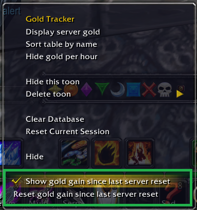
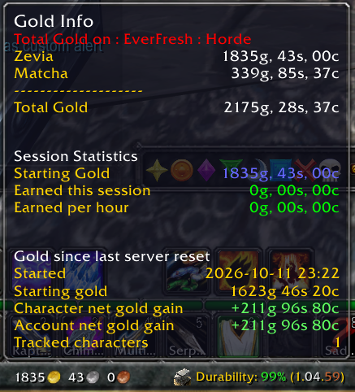

# Matcha's Everfresh reset gold tracking plugin for Titanpanel

Persistent character and account net gold gains between Everfresh server resets, integrated into the **built-in Titan Panel Gold Tracker** for **WoW WotLK 3.3.5** and **Titan Panel 4.3.8.30300**. TitanCurrency is separate and optional.

## Downloads

- [Download the gold tracking plugin](downloads/Matchas-Everfresh-reset-gold-tracking-plugin-for-Titanpanel.zip?raw=1)
- [Download original Titan Panel WotLK ZIP](https://github.com/Cacato/Matchas-Everfresh-reset-gold-tracking-plugin-and-TitanCurrency-fork/blob/main/downloads/felbite.com-titanpanel-wotlk-titan-panel.zip?raw=1)
- [Titan Panel source page on Felbite](https://felbite.com/addon/4497-titanpanel/)
- [Optional TitanCurrency fork](https://github.com/Cacato/Matchas-TitanCurrency-fork)

## Install

1. Completely close WoW and back up your `TitanGoldTracker` folder.
2. Install Titan Panel first if needed.
3. Extract this plugin ZIP into `Interface/AddOns`, replacing `TitanGoldTracker`. Keep that folder name.
4. Start WoW and enable the addon and built-in Gold Tracker.
5. Right-click the gold display and check **Show gold gain since last server reset**.

Installing the original Titan Panel ZIP afterward replaces the modified Gold Tracker. Reinstall this plugin afterward if needed. Replacing addon files preserves SavedVariables.

## Screenshots

### Enable tracking in Gold Tracker options

### Gold tracking tooltip

## Tracking and reset

The tooltip keeps the original gold/session information and adds tracking start date, starting gold, character net gain, account net gain, and number of tracked characters.

Use **Reset gold gain since last server reset** after the server wipe. The Yes/No confirmation resets baselines account-wide, across realms. The active character starts from its current gold. Other characters receive a fresh baseline at their next login; log into them before earning gold to capture the beginning of the season.

Net gain is current gold minus starting gold: spending reduces it. Account totals use the last recorded balances of characters visited with the addon. This is not a transaction history or total income before expenses.

Tracking survives `/reload` and normal logout. A crash can lose changes since the last SavedVariables write. Keep `TitanGoldTrackerResetDB` when upgrading. Legacy Currency tracking data is imported when available. Hiding the tooltip section preserves its baseline.

`/matchagolddebug` prints a small saved balance-change history to help diagnose unexpected changes. It does not reset your data.

## Credits and validation

Original Gold Tracker by **Poena @ Area 52 and the Titan Development Team**. Everfresh tracking maintained by **Matcha**. Felbite hosts the supplied Titan Panel WotLK distribution.

Lua 5.1 checks cover restoration into a fresh runtime, confirmed account resets, original menu/tooltip behavior, and bounded balance diagnostics. In-game tests confirmed a 211g 96s 80c gain remained unchanged after reload. An earlier incorrect baseline was not explained; reset tracking and diagnostics were used to monitor subsequent behavior.
